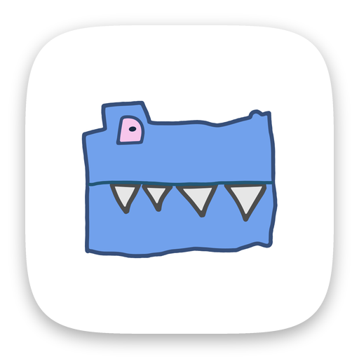

  

<h1 align="center">rqmts: prioritize requirements</h1>

Compare two requirements at a time and pick the more important one. The app sorts the whole list for you.

  
  &nbsp;
  

Flutter · Riverpod · Hive

## About the code

I built it with AI coding agents, starting in July 2025.

## Known issues

- There are no automated tests yet.
- The code generation packages (hive_generator, build_runner) need updating before it builds with Flutter 3.38.

© 2025–2026 Indest OÜ. All rights reserved.
